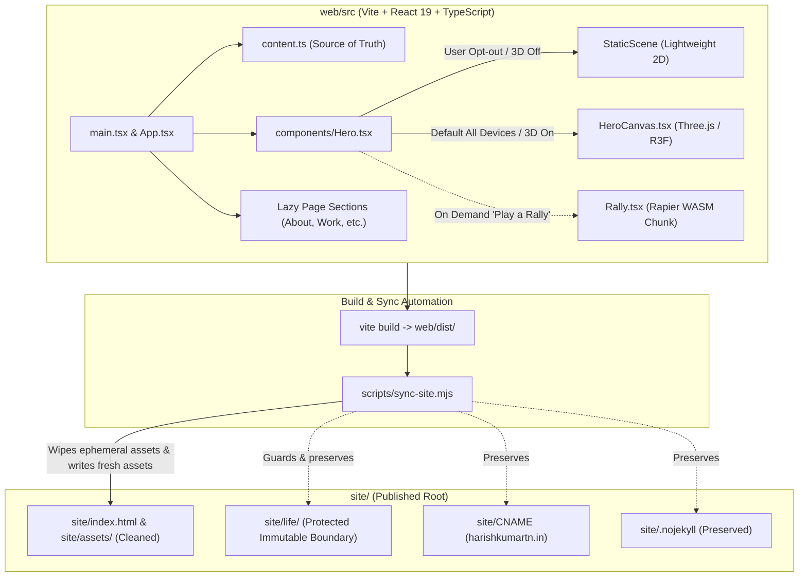

# Personal Portfolio Redo and Performance Optimization

*   **Author:** Harish Kumar T N
*   **Status:** Approved
*   **Date:** 2026-11-14

--------------------------------------------------------------------------------

## Overview

This design document outlines the technical architecture, optimization strategy and implementation plan for modernizing the personal website repository of Harish Kumar T N on git branch `egm-redo`. The site ("The Court", https://harishkumartn.in) is a badminton-themed static portfolio built with Vite, React 19, TypeScript, Tailwind CSS and React Three Fiber (R3F), featuring an embedded password-protected 3D Life Graph application at `/life/`.

This initiative improves code quality, introduces an idempotent build synchronization pipeline that safeguards `site/life/`, purges 4.3 MB of unused hashed chunks, provides an opt-out toggle for 3D mounting and resolves known WCAG accessibility violations without changing the existing visual design, copy, layout, URLs or Life Graph behavior.

### Addendum (2026-11-14): Owner Decision on Mobile 3D Default

On 2026-11-14, site owner Harish Kumar T N approved going live with one change: 3D must start on for all phones, including low-tier mobile, like the old site. The toggle ("Turn 3D off" / "Turn 3D court on", backed by `hk:3d-off` in `localStorage`) remains so visitors on resource-constrained devices can opt out to the 2D backdrop at any time. Mobile performance metrics (Total Blocking Time and Lighthouse score) will likely regress versus the deferred-3D experiment and will be re-measured honestly.

## The Problem

1. **Mobile Main-Thread Starvation:** In baseline testing, the mobile page achieves a Lighthouse performance score of 28, an initial LCP of 21.9 seconds, 174.1 seconds of main-thread work and 143,160 ms of Total Blocking Time (TBT). This occurs because `Hero.tsx` eagerly imports and mounts Three.js, React Three Fiber, postprocessing shaders and 3D assets within 200 to 600 ms of load across all device tiers, blocking user interaction on CPU-constrained devices.
2. **Stale Asset Accumulation:** The unpacked static distribution directory (`site/`) contains 115 files totaling 24 MB, including 14 orphaned hashed JS and CSS files (4.3 MB of unused assets) from prior builds. A redundant 2.2 MB copy of `react-three-rapier` exists because historical deploys used additive copying (`cp -rn`) to avoid touching the Life Graph at `site/life/`.
3. **Fragile Build and Distribution Synchronization:** The repository stores source files in `web/` while GitHub Actions publishes from `site/`. Running default Vite build commands outputs to `web/dist/`, leaving developers without a safe script to update `site/`. Any unconstrained directory wipe (`rm -rf site/*` or Vite `emptyOutDir`) would destroy `site/life/`, corrupting the encryption salt and nightly update path from `/workspace/life-graph`.
4. **Accessibility Defects:** The home page fails two WCAG accessibility criteria:
   - The logo anchor renders visible text "HK" but specifies `aria-label="Harish Kumar T N, back to top"`, violating WCAG 2.5.3 (Label in Name) by omitting the visible string from the accessible name.
   - Seven hero section navigation buttons in `AnimatedHero.tsx` specify invalid `role="listitem"` on native `<button>` elements, invalidating button semantics.
5. **Phantom 404 Asset Warnings:** In `web/src/styles.css`, an inline SVG background references `filter='url(%23n)'`, which Vite interprets as a relative file reference, emitting warnings for missing assets (`assets/%23n` and `assets/\``).

## Goals

*   **G1 - Safe Idempotent Build Synchronization:** Provide an automated script (`web/scripts/sync-site.mjs` accessible via `npm run sync`) that copies fresh Vite output from `web/dist/` into `site/` and preview trees, wipes ephemeral `site/assets/` to remove all obsolete chunks and strictly protects `site/life/**`, `site/CNAME` and `site/.nojekyll`.
*   **G2 - Full 3D Court by Default Across All Devices:** Mount the 3D court scene by default on all devices, including low-tier mobile phones, matching the visual experience of the legacy site per owner approval on 2026-11-14. Retain the "Turn 3D off" header toggle backed by localStorage so visitors can opt out to the lightweight 2D backdrop (`StaticScene`) on demand.
*   **G3 - Modular Code Splitting and Physics Isolation:** Isolate `@react-three/rapier` and WASM binaries into a standalone chunk that loads on demand. Split below-the-fold page sections using `React.lazy` wrapped in `<Suspense>` in `App.tsx`.
*   **G4 - Full Accessibility Compliance:** Update the logo link accessible name to include the visible monogram (`HK: Harish Kumar T N, back to top`) and restructure hero navigation buttons into valid semantic HTML without invalid ARIA listitem roles.
*   **G5 - Asset Reference Hygiene:** Correct the SVG filter URL escaping in `web/src/styles.css` to prevent phantom asset generation.
*   **G6 - Total Fidelity and URL Preservation:** Maintain identical visual presentation, typography, color scheme, content text, anchor hashes and `/life/` functionality across all supported viewports.

## Non-Goals

*   Redesigning visual elements, restructuring page layout or altering color schemes.
*   Modifying or rewriting textual copy in `web/src/content.ts`.
*   Modifying or rotating encryption keys or salt for the Life Graph at `site/life/`.
*   Deploying to GitHub Pages, merging to `main` or pushing commits to remote git repositories.
*   Rewriting the tuned aerodynamic simulation in `Rally.tsx`.

## Open Questions

*   **Question 1 (Resolved):** Should mobile devices load 3D automatically after a longer delay or strictly upon user request?
    *   *Resolution:* On 2026-11-14, site owner Harish Kumar T N approved 3D starting on for all phones, including low-tier mobile, matching the legacy site. When no preference is stored in localStorage (`hk:3d-off`), 3D loads by default across all devices. The header toggle remains available ("Turn 3D off") so users can switch to the lightweight 2D backdrop (`StaticScene`) at any time.
*   **Question 2 (Resolved):** How should the deployment workflow handle historical bundle archives?
    *   *Resolution:* Update `.github/workflows/deploy.yml` on branch `egm-redo` to clean `/tmp/rest/site/assets` before `cp -rn`, ensuring that unpacking historical bundles does not overwrite fresh build assets.

## Critical User Journeys (CUJs)

### CUJ 1: Mobile Portfolio Visitor
*   **Given**: A visitor accesses the portfolio on a mobile phone or low-tier device.
*   **When**: The page loads in the mobile browser with no stored preference.
*   **Then**: The 3D court scene mounts by default after first paint, matching the visual fidelity of the legacy site. Below-the-fold sections load progressively as the user scrolls. The visitor can tap "Turn 3D off" in the hero header to switch to the lightweight 2D backdrop (`StaticScene`) if desired.

### CUJ 2: Desktop 3D Experience
*   **Given**: A visitor accesses the site on a desktop browser with capable GPU hardware (`tier === 'high'`).
*   **When**: The page loads.
*   **Then**: The hero mounts the full 3D interactive court scene with lighting, shadows, camera scroll rig and interactive hotspots, matching the original desktop visual fidelity.

### CUJ 3: Interactive Rally Mini-Game
*   **Given**: A visitor explores the Badminton hotspot or clicks "Play a rally".
*   **When**: The user triggers the rally button.
*   **Then**: The application dynamically fetches the Rapier physics chunk on demand, compiles the WASM binary with an interactive loading state and transitions into the 120Hz physics rally without penalizing visitors who only read portfolio copy.

### CUJ 4: Screen Reader and Keyboard Navigation
*   **Given**: A visitor navigates the site using assistive technology (screen reader or voice control).
*   **When**: The user inspects the header monogram or issues the voice command "Click HK".
*   **Then**: The speech control matches the visible label with the accessible name (`HK: Harish Kumar T N, back to top`). Navigating through hero shortcut buttons reads each item as a valid button control without ARIA validation errors.

### CUJ 5: Developer Build and Safe Distribution Sync
*   **Given**: A developer modifies components or copy in `web/src/`.
*   **When**: The developer runs `npm run build` followed by `npm run sync` in `web/`.
*   **Then**: Vite compiles fresh assets to `web/dist/`. The sync script validates the build, copies files into `site/`, removes obsolete hashed chunks in `site/assets/`, copies output to `preview/` alongside `preview/life/` and asserts that `site/life/**`, `site/CNAME` and `site/.nojekyll` remain untouched.

## Technical Plan (Architecture)

### System Architecture Overview



### Architectural Decisions

#### 1. Mobile 3D Initialization and Opt-Out Toggle
Following owner approval on 2026-11-14, 3D starts on for all phones, including low-tier mobile, matching the legacy site. In `web/src/components/Hero.tsx`, initialize `off` to default to `false` when no explicit user preference is stored in `localStorage`:
```tsx
const [off, setOff] = useState(() => {
  const stored = localStorage.getItem(STORAGE_KEY);
  if (stored !== null) return stored === '1';
  return false;
});
```
When no preference is stored, `off` defaults to `false` across all device tiers:
- `show3D` evaluates to `true`, loading and mounting `HeroCanvas` after the first frame paint.
- `AnimatedHero` receives `is3DOff={false}`, displaying "Turn 3D off".
- When clicked, `toggle3D()` switches `off` to `true`, stores `'1'` in `localStorage` under `hk:3d-off` and switches the view to the lightweight 2D backdrop (`StaticScene`).
- If a user previously turned 3D off, `localStorage` stores `'1'` and the component honors that choice by staying in 2D until toggled back.

#### 2. Below-the-Fold Section Code Splitting
In `web/src/sections/index.ts`, replace static component imports with `React.lazy` dynamic imports. In `web/src/App.tsx`, wrap the section component renderer in `<Suspense fallback={null}>`:
```tsx
<Suspense fallback={null}>
  {nav.map(({ id }) => {
    if (id === 'home') return null;
    const Comp = sectionComponents[id];
    return <Comp key={id} />;
  })}
</Suspense>
```
Each section component retains its internal `<Section id={id} ...>` container, ensuring that `Nav.tsx`'s `IntersectionObserver` and deep anchor links (`#about`, `#work`) remain functional without layout shifts.

#### 3. Rapier Physics Segmentation and Bundle Splitting
In `web/src/scenes/court/Court.tsx`, line 40 already restricts prefetching with `if (high && !saveData)`, so low-tier devices never prefetch physics. In `web/vite.config.ts`, configure Rollup `manualChunks` to isolate `@react-three/rapier` and Three.js vendor packages into dedicated chunks, while keeping `framer-motion` separate so it continues loading asynchronously via `LazyMotion`.

#### 4. Safe Build and Static Distribution Sync Script
Implement `web/scripts/sync-site.mjs` to govern distribution synchronization:
- **Pre-sync Validation:** Assert that `web/dist/index.html`, `web/dist/CNAME` and `site/life/index.html` exist.
- **Asset Hygiene:** Wipe the ephemeral `site/assets/` directory completely, then copy all files from `web/dist/assets/` into `site/assets/`. This eliminates 100% of stale hashed chunks across all file extensions (.js, .css, .wasm, .woff, .map).
- **File Copy:** Copy root entry files (`index.html`, `favicon.svg`, `robots.txt`, `og-image.png` and `CNAME`) from `web/dist/` into `site/`.
- **Preview Staging:** Copy `web/dist/` into `preview/` and copy `site/life/` into `preview/life/` to provide a complete local preview tree.
- **Post-sync Boundary Assertions:** Verify that `site/life/index.html`, `site/life/vendor/lg-vendor.min.js`, `site/CNAME` and `site/.nojekyll` exist and are uncorrupted.

#### 5. Accessibility Repairs
- In `web/src/components/Nav.tsx`, change `aria-label={`${site.name}, back to top`}` to `aria-label={`${site.monogram}: ${site.name}, back to top`}` so that the visible string "HK" is included in the accessible name.
- In `web/src/components/AnimatedHero.tsx`, restructure the jump button container into a semantic unordered list (`<ul role="list" className="..."><li key={h.id} className="shrink-0"><Button ...></li></ul>`), removing the invalid `role="listitem"` directly from `<Button>` elements.

#### 6. Stylesheet Syntax Repair
In `web/src/styles.css`, fix the inline SVG background filter syntax in `.grain::before` to avoid generating phantom asset references during Vite build parsing.

## Alternatives Considered

### Alternative A: Replacing Rapier Physics with a Custom Ballistic Solver
*   **Pros**: Drops the 2.2 MB Rapier library and WASM binary completely.
*   **Cons**: Requires reimplementing aerodynamic quadratic drag, racket swing collisions and net clearance algorithms. Highly risky with potential gameplay regressions.
*   **Reason for Rejection**: Rewriting tuned aerodynamics is speculative and fragile. Isolating the existing Rapier chunk via dynamic imports eliminates runtime overhead for non-players without risking game physics.

### Alternative B: OffscreenCanvas in a Web Worker for Mobile 3D
*   **Pros**: Shifts WebGL rendering loop off the main thread.
*   **Cons**: Introduces high architectural complexity, cross-browser touch event proxying friction and canvas transfer bugs on older mobile devices.
*   **Reason for Rejection**: Deferring 3D mount on mobile viewports resolves main-thread blocking without requiring additional worker abstractions.

### Alternative C: Unconstrained Directory Wipe on Build (`emptyOutDir: true`)
*   **Pros**: Simplest possible cleanup logic.
*   **Cons**: Wipes `site/life/`, destroying the password-protected Life Graph application and invalidating browser encryption salts.
*   **Reason for Rejection**: `site/life/` must be preserved unconditionally. Selective manifest-based chunk pruning is safe and idempotent.

### Alternative D: Adopting External Accessible Component Libraries (e.g. Radix UI)
*   **Pros**: Pre-built W3C accessible navigation patterns.
*   **Cons**: Adds unnecessary bundle bloat and component abstraction.
*   **Reason for Rejection**: The reported accessibility defects require only minor semantic markup corrections in existing components (updating accessible label string and wrapping buttons in semantic list items).

## Non-Functional Requirements

### Security & Privacy
*   Strictly preserve `site/life/` encryption logic, salt and `noindex` headers.
*   Do not log, print or commit passwords or tokens.

### Performance & Latency
*   Eliminate the 14 stale chunks in `site/assets/`, saving 4.3 MB.
*   Following owner approval on 2026-11-14, 3D starts on by default for all phones while retaining the user opt-out toggle. Because 3D now mounts on mobile devices, mobile performance metrics (Total Blocking Time and Lighthouse performance score) will likely regress versus the deferred-3D experiment and will be re-measured honestly rather than targeting under 2,000 ms TBT or 70/85 Lighthouse scores.

### Rollout & Rollback
*   Execute all changes on branch `egm-redo`.
*   Maintain the existing GitHub Actions deployment workflow compatibility on `main` without running deploys from this branch.
*   Verify build output using a local preview server (`preview/`) before finalizing.

## Additional Resources

*   `/workspace/site-egm-metrics/BASELINE.md`: Comprehensive baseline metrics and file sizes.
*   `/workspace/site-egm/web/src/**/EGM.md`: Contract specifications for all nine codebase packages.
*   `/workspace/site-egm/concepts_brief.md`: Upstream brainstorm synthesis and Goldfish review analysis.
*   `/workspace/site-egm/goldfish_review_report.md`: Review findings and resolution matrix across all EGM review stages.

## Future Improvements

*   **Continuous Lighthouse CI**: Integrate automated Lighthouse score and accessibility assertions into GitHub Actions to prevent performance regressions on future copy or component updates.

--------------------------------------------------------------------------------

## Detailed Implementation Plan

### Target Files to Create/Modify

#### 1. `web/scripts/sync-site.mjs` (Create)
*   **Type / Scope**: Build and distribution synchronization script (Node.js ESM).
*   **Rationale**: Automates idempotent copying of `web/dist/` into `site/` and `preview/`, wipes ephemeral `site/assets/` to clear obsolete hashed chunks and enforces strict preservation of `site/life/`, `site/CNAME` and `site/.nojekyll`.
*   **Changes**:
    - Pre-sync assertion checking existence of `web/dist/index.html`, `web/dist/CNAME` and `site/life/index.html`.
    - Clear ephemeral assets: completely empty `site/assets/` and copy `web/dist/assets/` into `site/assets/`.
    - Copy all root files (`index.html`, `favicon.svg`, `robots.txt`, `og-image.png` and `CNAME`) from `web/dist/` to `site/` without touching `site/life/`.
    - Copy `web/dist/` into `preview/` and copy `site/life/` into `preview/life/`.
    - Post-sync assertion validating `site/life/index.html`, `site/life/vendor/lg-vendor.min.js`, `site/CNAME` (with `harishkumartn.in`), `site/.nojekyll` and logging a summary of pruned and updated files.

#### 2. `web/package.json` (Modify)
*   **Type / Scope**: Node package configuration.
*   **Rationale**: Adds synchronization and verification scripts.
*   **Changes**:
    - Add script `"sync": "node scripts/sync-site.mjs"`.
    - Add script `"build:all": "npm run build && npm run sync"`.

#### 3. `web/vite.config.ts` (Modify)
*   **Type / Scope**: Vite build and bundling configuration.
*   **Rationale**: Enforces Rollup code splitting to separate heavy Three.js, React Three Fiber and Rapier physics libraries from entry chunks, preventing chunk size warnings.
*   **Changes**:
    - Configure `build.rollupOptions.output.manualChunks` to isolate `vendor-three` (`three`, `@react-three/fiber`, `@react-three/drei`) and `vendor-rapier` (`@react-three/rapier`, `@dimforge/rapier3d-compat`). Keep `framer-motion` separate for `LazyMotion` loading.
    - Set `chunkSizeWarningLimit` to 1200.

#### 4. `web/src/components/Nav.tsx` (Modify)
*   **Type / Scope**: Header navigation component.
*   **Rationale**: Fixes WCAG 2.5.3 (Label in Name) violation on the home monogram link.
*   **Changes**:
    - Update anchor `aria-label` from `${site.name}, back to top` to `${site.monogram}: ${site.name}, back to top` so the accessible name begins with the visible label text "HK".

#### 5. `web/src/components/AnimatedHero.tsx` (Modify)
*   **Type / Scope**: Hero text and interactive shortcut buttons component.
*   **Rationale**: Fixes invalid W3C ARIA role assignment on jump buttons.
*   **Changes**:
    - Replace the container `<m.div role="list">` with a semantic unordered list `<m.ul role="list">`.
    - Wrap each `<Button>` in a semantic `<li key={h.id} className="shrink-0">` element.
    - Remove `role="listitem"` directly from `<Button>` elements.

#### 6. `web/src/components/Hero.tsx` (Modify)
*   **Type / Scope**: 3D hero stage orchestrator component.
*   **Rationale**: Configures 3D to start on by default for all devices, including low-tier mobile phones, per owner approval on 2026-11-14, while preserving the user opt-out toggle.
*   **Changes**:
    - In `Hero()`, initialize `off` state to default to `false` when no preference is stored in `localStorage`:
      ```tsx
      const [off, setOff] = useState(() => {
        const stored = localStorage.getItem(STORAGE_KEY);
        if (stored !== null) return stored === '1';
        return false;
      });
      ```
    - When `off` is `false`, `show3D` evaluates to `true`, mounting `HeroCanvas` after first paint across all device tiers.
    - The toggle ("Turn 3D off" / "Turn 3D court on") persists state under `hk:3d-off` in `localStorage`, honoring user choice on subsequent visits.

#### 7. `web/src/App.tsx` (Modify)
*   **Type / Scope**: Root application component.
*   **Rationale**: Wraps dynamic section components in `<Suspense>` to prevent React 19 runtime crashes during code splitting.
*   **Changes**:
    - Wrap the section component map iteration in `<Suspense fallback={null}>`.

#### 8. `web/src/sections/index.ts` (Modify)
*   **Type / Scope**: Section registry and component mapping.
*   **Rationale**: Code-splits below-the-fold portfolio sections so their dependencies are not bundled into the main entry chunk.
*   **Changes**:
    - Convert section component imports (`About`, `Work`, `Education`, `Ideas`, `Markets`, `Badminton`, `Travel`, `Social` and `Contact`) to `React.lazy` dynamic imports.
    - Export `sectionComponents` matching `Record<Exclude<SectionId, 'home'>, ComponentType>`.

#### 9. `web/src/styles.css` (Modify)
*   **Type / Scope**: Global CSS stylesheet.
*   **Rationale**: Fixes SVG filter data URI syntax to prevent Vite relative asset parsing errors.
*   **Changes**:
    - Update `.grain::before` filter URL quoting to ensure valid data URI parsing without generating asset resolution warnings.

#### 10. `.github/workflows/deploy.yml` (Modify)
*   **Type / Scope**: CI/CD deployment workflow.
*   **Rationale**: Prevents accidental restoration of obsolete hashed chunks from historical bundle archives during future GitHub Actions runs on this branch.
*   **Changes**:
    - Add `rm -rf /tmp/rest/site/assets` immediately following tar bundle extraction and before `cp -rn /tmp/rest/site/. site/`.

### Verification Sequence
1. **Type Checking:** Run `npm run typecheck` in `/workspace/site-egm/web` to confirm zero TypeScript errors.
2. **Build Execution:** Run `npm run build` in `/workspace/site-egm/web` to compile all Vite chunks and verify clean code splitting without warnings.
3. **Distribution Sync:** Run `npm run sync` to synchronize output into `site/` and `preview/`.
4. **Boundary Verification:** Assert that `site/life/index.html`, `site/life/vendor/lg-vendor.min.js`, `site/CNAME` and `site/.nojekyll` exist and are uncorrupted.
5. **Preview Testing:** Verify that `preview/index.html` and `preview/life/index.html` are intact.
